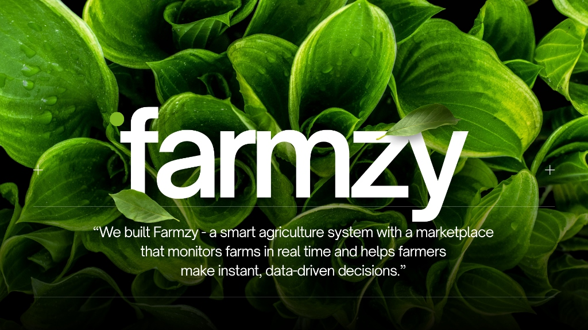

# Farmzy



> *"We built Farmzy — a smart agriculture system with a marketplace that monitors farms in real time and helps farmers make instant, data-driven decisions."*

📊 **Project Slides & Overview:** [View Presentation (PPT)](https://canva.link/tm3pw0pfgxw8cic) *(Read more about the design, problem statement, and impact)*

🌐 **Live Deployment:** [farmzy.joanathan.in](https://farmzy.joanathan.in)

---

## 🌾 Core Modules

Farmzy unifies four autonomous agricultural engines into a single platform:

### 1. 🧪 Soilytics (Soil Intelligence Engine)
- **Live IoT Ingestion:** Collects NPK (Nitrogen, Phosphorus, Potassium), pH, and volumetric moisture data directly from ESP32 telemetry via ThingSpeak.
- **Degradation & Depletion Analysis:** Tracks rate-of-depletion across harvest cycles, predicting soil exhaustion before visible crop damage occurs.
- **Smart Recommendations:** Generates actionable fertilizer, lime, and organic amendment prescriptions with cost estimates and priority flags.

### 2. 💧 HydroIQ (Precision Irrigation Intelligence)
- **Evapotranspiration (ET₀) Engine:** Computes reference crop evapotranspiration using the FAO Hargreaves thermodynamic formula.
- **Weather Forecast Synthesis:** Integrates live rainfall forecasts from OpenWeatherMap to prevent unnecessary watering and nutrient leaching.
- **Zone Scheduling:** Computes exact net water demand in liters per zone, cycle runtimes, and split application timing.

### 3. 🛒 Marketplace (Direct Farmer-to-Buyer Trade)
- **Soil-Score Dynamic Pricing:** Quality grades (A+, A, B, C) and base price multipliers are automatically calculated from verified soil health ratings.
- **Transparent Order Matching:** Direct connections between verified farms and bulk wholesale buyers without exploitative middlemen.
- **Realtime Availability:** Live inventory and price discovery backed by Supabase Realtime subscriptions.

### 4. 🚚 AgroGo (Rural Route Pooling & Logistics)
- **Aggregated Pickups:** Clusters regional harvest pickups to cut transport overhead for smallholder farmers.
- **Dynamic Routing:** Computes the shortest pickup sequence and cost breakdowns (distance base rate + per-stop handling fees).

---

## 🏗️ System Architecture

```
                    ┌─────────────────────────┐
                    │  ESP32 Hardware Sensors  │
                    └───────────┬─────────────┘
                                │ (Telemetry)
                                ▼
                    ┌─────────────────────────┐
                    │    ThingSpeak Cloud     │
                    └───────────┬─────────────┘
                                │
                                ▼
┌─────────────────────────────────────────────────────────────┐
│                   FastAPI Backend (Python)                  │
│  ├── Soilytics Engine       ├── HydroIQ (Hargreaves ET₀)    │
│  ├── Marketplace Engine     └── AgroGo Routing Engine       │
└──────────────┬───────────────────────────────┬──────────────┘
               │                               │
               ▼                               ▼
┌─────────────────────────────┐ ┌─────────────────────────────┐
│    Supabase Cloud DB &      │ │   AstroWind UI (Astro 5)    │
│       REST API (PostgREST)  │ │   Tailwind CSS / TypeScript │
└─────────────────────────────┘ └─────────────────────────────┘
```

---

## 📁 Repository Structure

```
Farmzy1/
├── assets/
│   └── farmzy-banner.jpg      # Project banner
├── app/                       # FastAPI Backend
│   ├── agrogo/                # Rural delivery & route pooling engine
│   ├── api/                   # REST API routers (soil, irrigation, marketplace, delivery, unified)
│   ├── core/                  # Shared farm models & schemas
│   ├── hydroiq/               # Precision irrigation & ET0 engine
│   ├── marketplace/           # Dynamic quality-price marketplace engine
│   ├── soilytics/             # Soil telemetry & ThingSpeak client
│   ├── config.py              # Application settings (Pydantic)
│   ├── database.py            # Database fallback handler
│   ├── supabase_client.py     # Direct Supabase REST / PostgREST client
│   └── main.py                # FastAPI entry point
├── frontend/                  # Astro 5 + Tailwind Frontend
│   ├── src/
│   │   ├── pages/             # Pages (/, /soilytics, /hydroiq, /marketplace, /agrogo)
│   │   ├── lib/api/           # API integration clients
│   │   ├── components/        # Reusable UI widgets & layouts
│   │   └── navigation.ts      # Navigation config
│   ├── package.json
│   └── astro.config.ts
├── supabase_schema.sql        # Complete Supabase PostgreSQL schema & realtime policies
├── run.bat                    # One-click startup script for Windows
├── requirements.txt           # Python dependencies
└── README.md
```

---

## 🚀 Quickstart

### Option A: One-Click Startup (Windows)
Double-click [`run.bat`](run.bat) or run from PowerShell:
```bat
run.bat
```
This automatically launches the FastAPI backend on `http://localhost:8000` and the Astro frontend on `http://localhost:4321`.

### Option B: Manual Setup

#### 1. Backend (FastAPI)
```bash
pip install -r requirements.txt
uvicorn app.main:app --reload --host 0.0.0.0 --port 8000
```
- API root: `http://localhost:8000`
- Interactive OpenAPI Docs: `http://localhost:8000/docs`

#### 2. Frontend (Astro)
```bash
cd frontend
npm install
npm run dev
```
- Web Application: `http://localhost:4321`

---

## 🗄️ Database Setup (Supabase)

Farmzy connects directly to **Supabase** via standard REST API endpoints (no database passwords or direct connection strings required).

1. Create a project at [supabase.com](https://supabase.com).
2. Open the **SQL Editor** in your Supabase Dashboard and run [`supabase_schema.sql`](supabase_schema.sql).
3. Set your Supabase URL and Anon/Publishable Key in your `.env`:
   ```env
   SUPABASE_URL=https://[YOUR-PROJECT-REF].supabase.co
   SUPABASE_KEY=[YOUR-SUPABASE-KEY]
   ```

---

## ☁️ Vercel Deployment (`farmzy.joanathan.in`)

1. Connect the repository in Vercel.
2. In **Project Settings**:
   - **Root Directory**: `frontend`
   - **Framework Preset**: `Astro`
   - **Build Command**: `npm run build`
   - **Output Directory**: `dist`
3. Add Environment Variables:
   - `PUBLIC_SITE_URL`: `https://farmzy.joanathan.in`
   - `PUBLIC_API_URL`: Your hosted backend endpoint
   - `PUBLIC_SUPABASE_URL`: `https://[YOUR-PROJECT-REF].supabase.co`
   - `PUBLIC_SUPABASE_ANON_KEY`: `[YOUR-SUPABASE-KEY]`

---

## 📄 Documentation & Links

- 📊 [Presentation Slides & Pitch Deck (PPT)](https://canva.link/tm3pw0pfgxw8cic)
- 🌐 [Production Site](https://farmzy.joanathan.in)
- 📝 [License & Terms](frontend/src/pages/terms.md)
